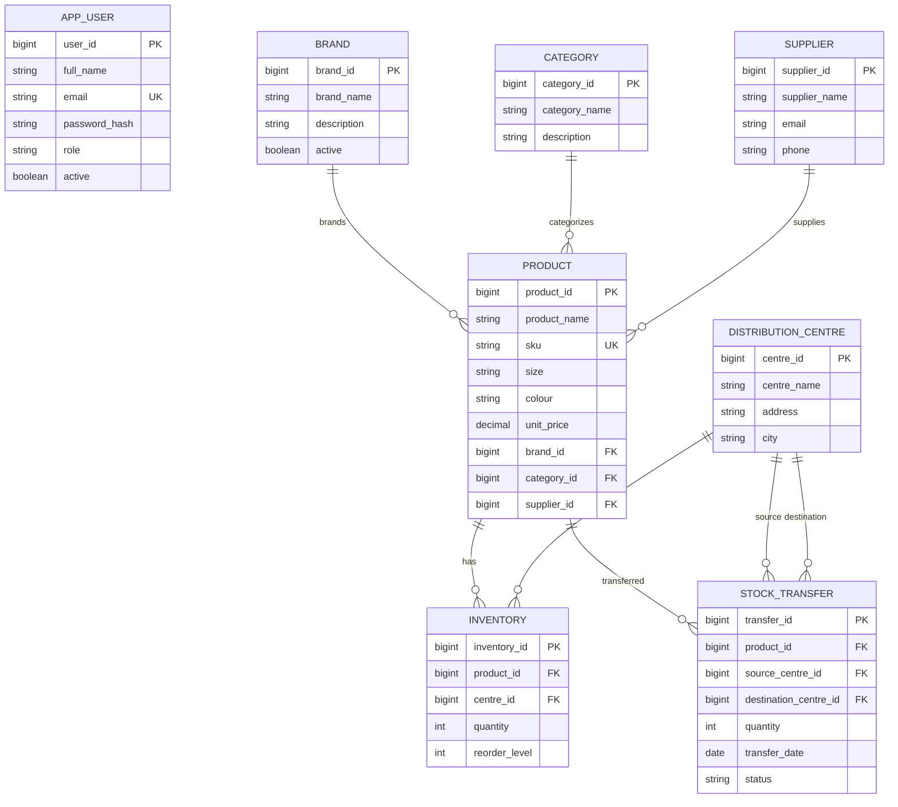

# StyleStock ER Diagram

Paste the Mermaid code below into https://mermaid.live to render/export the diagram as PNG or SVG.

Note: AppUser is included as a planned domain entity in the ER model. This prototype uses in-memory Spring Security accounts for authentication.
